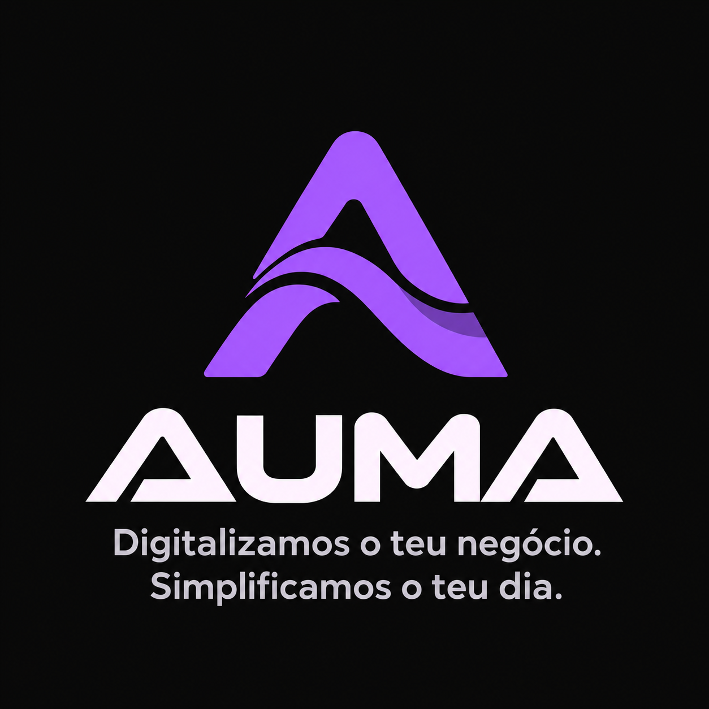

### AN AUMA TEAM DIGITAL EXPERIENCE

# ZAMANI
### African Heritage Kitchen

*Where African heritage meets modern dining.*

**Designed & Developed by AUMA Team**

`Web Design` • `Web Development` • `UI/UX Design`

---

## ✨ About the Project

**Zamani African Heritage Kitchen** is a modern, elegant and interactive restaurant website designed to celebrate the richness, diversity and authenticity of African cuisine.

The project brings together cultural storytelling, sophisticated visuals and intuitive functionality to create a memorable digital dining experience.

From exploring traditional African dishes to discovering the restaurant's identity, every detail was thoughtfully crafted to connect culture, hospitality and technology.

**Zamani is a digital experience proudly developed by the AUMA Team.**

---

## 🖥️ Website Preview

*The Zamani African Heritage Kitchen digital experience.*

---

## 🎬 Website Walkthrough

Take a closer look at the Zamani experience through our 30-second website showcase.

**[▶ Watch the 30-Second Website Preview](assets/zamani-preview-30s.mp4)**

*Preview video will be available soon.*

---

## 🌟 Key Features

### Elegant & Modern Interface
A visually immersive website combining refined typography, carefully selected imagery and an African-inspired colour palette.

### Interactive Food Menu
An organised digital menu allowing visitors to discover dishes, ingredients, prices and culinary inspirations.

### Restaurant Reservations
An interactive reservation interface designed to make the dining planning experience simple and intuitive.

### Responsive Design
A seamless browsing experience optimised for desktops, tablets and smartphones.

### African Cultural Identity
A design concept celebrating African culinary traditions through storytelling, imagery and thoughtful visual details.

### WhatsApp Integration
Convenient communication links enabling visitors to reach the restaurant directly.

---

## 🎨 Design Philosophy

At AUMA, we believe that a website should do more than display information.

It should tell a story, communicate identity and create meaningful connections between businesses and their audiences.

For Zamani, our design approach focused on:

- **Elegance:** Sophisticated layouts and visual harmony.
- **Culture:** Celebrating African heritage and authenticity.
- **Usability:** Clear navigation and intuitive interactions.
- **Responsiveness:** Beautiful experiences across devices.
- **Brand Identity:** Giving the restaurant a distinctive digital personality.

The result is a digital experience where tradition and modern technology meet.

---

## 🛠️ Technologies Used

| Technology | Purpose |
|---|---|
| React | Interactive user interface |
| TypeScript | Application development |
| Vite | Modern frontend tooling |
| Tailwind CSS | Responsive styling |
| Lucide Icons | Interface iconography |

---

## 🚀 Developed by AUMA Team

**AUMA** is a creative technology team focused on transforming ideas into innovative, functional and visually compelling digital experiences.

We combine creativity, modern web technologies and user-centred design to help brands establish a meaningful digital presence.

Our approach goes beyond building websites. We aim to create digital solutions that reflect each brand's identity, engage its audience and deliver lasting value.

**Our Focus**
- Website Design & Development
- UI/UX Design
- Digital Experiences
- Creative Technology Solutions
- Business Digitalisation

---

## 📌 Project Information

**Project:** Zamani African Heritage Kitchen

**Category:** Restaurant & Hospitality Website

**Project Type:** Website Concept / Portfolio Showcase

**Design & Development:** AUMA Team

**Status:** Portfolio Demonstration

*Note: The reservation interface is demonstrative and does not currently confirm real restaurant bookings.*

---

### AUMA
**CREATIVE TECHNOLOGY & DIGITAL EXPERIENCES**

*Turning ideas into meaningful digital experiences.*

**Proudly Designed & Developed by AUMA Team**

© 2026 AUMA. All Rights Reserved.

